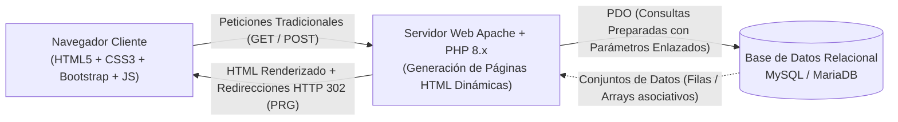
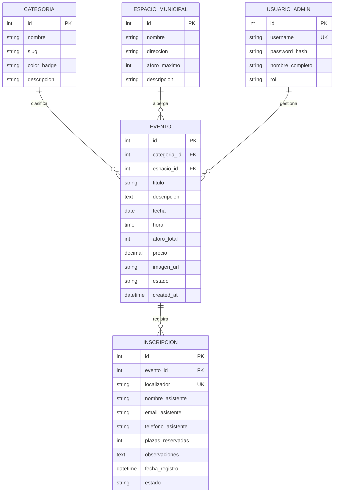
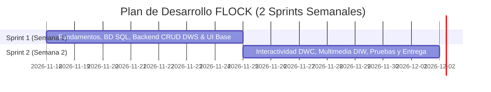

# 🏛️ FLOCK — Agenda Cultural Municipal
## Documento de Propuesta Inicial y Especificación de Alcance
**Temática Curricular Oficial:** FLOCK — Agenda Cultural (Propuesta 1 de `PROYECTO1.docx`)  
**Proyecto Intermodular:** DWC (Cliente), DWS (Servidor) y DIW (Diseño de Interfaces)  
**Ciclo Formativo:** 2º Desarrollo de Aplicaciones Web (DAW) — Primer Trimestre  
**Equipo de Desarrollo:** Grupo REDBULL  (RDB)
**Repositorio GitHub:** [bbaakkuu-svg/EvenHub-Agenda-Cultural](https://github.com/bbaakkuu-svg/EvenHub-Agenda-Cultural)  
**Tablero de Gestión:** [GitHub Projects — Flock (#12)](https://github.com/users/bbaakkuu-svg/projects/12)  
**Estado:** Propuesta Inicial para Validación y Aprobación Docente  

---

## 🎯 1. Resumen Ejecutivo y Objetivo de la Aplicación

**FLOCK** materializa la propuesta temática oficial **EventHub — Agenda cultural**, adaptada institucionalmente como la **Agenda Cultural Oficial de una localidad** (Ayuntamiento de *Villaverde de la Ribera*), orientada a digitalizar, centralizar y dinamizar la vida cultural y vecinal del municipio.

El objetivo principal es ofrecer a la ciudadanía un canal accesible, moderno y unificado donde consultar la programación cultural mediante un **calendario mensual visual e interactivo**, explorar actividades por categorías y sedes municipales, y formalizar su **inscripción y reserva de plazas en tiempo real de forma inmediata y sin trabas burocráticas**.

A su vez, la herramienta dota a los técnicos municipales de la **Concejalía de Cultura** de un panel de control seguro para planificar, publicar y mantener el catálogo de eventos, supervisar los aforos disponibles y auditar los listados de vecinos inscritos.

---

## 👥 2. Público Objetivo y Propuesta de Valor

### 2.1. Público Objetivo
La plataforma se dirige a dos grandes grupos de usuarios:
1. **Población General y Ciudadanía Local:** Vecinos y visitantes que buscan opciones de ocio cultural accesible y de cercanía, con especial atractivo para jóvenes y adultos (16 a 45 años) interesados en propuestas participativas.
2. **Colectivos Artísticos y Creadores Emergentes:** Bandas de música, compañías de teatro independiente, artistas plásticos y talleristas locales cuyos eventos son acogidos y difundidos en los espacios del municipio.

### 2.2. Propuesta de Valor
* **Centralización Institucional:** Reemplaza la cartelería dispersa y folletos en papel por un portal web responsive y permanentemente actualizado.
* **Descubrimiento Visual e Intuitivo:** Integración de un **calendario híbrido** que permite una visión global del mes, resaltando los días con actividad cultural.
* **Inscripción Ciudadana sin Fricción:** Los vecinos pueden reservar plazas en eventos con aforo limitado indicando únicamente datos de contacto básicos, recibiendo de inmediato un localizador único de reserva, sin necesidad de trámites administrativos engorrosos ni registro forzoso previo.
* **Puesta en Valor de los Espacios Municipales:** Visibiliza la red de recintos públicos acondicionados para el encuentro ciudadano.

---

## 📍 3. Contexto Municipal y Espacios Culturales

El municipio articulador (*Villaverde de la Ribera*) cuenta con una red de cinco sedes públicas emblemáticas categorizadas en el sistema:

| Espacio Municipal | Tipología de Recinto | Aforo Promedio | Usos Principales |
| :--- | :--- | :---: | :--- |
| **Espacio Joven "La Nave"** | Centro polivalente contemporáneo | 120 plazas | Arte urbano, cinefórum, música acústica y networking |
| **Auditorio Municipal Ribera** | Teatro y sala de conciertos principal | 350 plazas | Festivales, conciertos orquestales y artes escénicas |
| **Centro Cívico "El Molino"** | Espacio vecinal de talleres y salas | 60 plazas | Conferencias, charlas divulgativas y talleres prácticos |
| **Plaza de las Artes** | Recinto exterior peatonal | 500 plazas | Festivales al aire libre, conciertos masivos y ferias |
| **Cinefórum Central** | Sala audiovisual histórica adaptada | 90 plazas | Ciclos de cine independiente, debates y ponencias |

---

## 🎭 4. Categorías Culturales (Enfoque Contemporáneo)

Los eventos programados en FLOCK se clasifican en cinco ejes temáticos con identificadores visuales (*badges* de color):
1. **Festivales y Encuentros:** Macroeventos temáticos culturales y festivales vecinales.
2. **Cinefórum y Audiovisual:** Proyecciones de cine independiente acompañadas de coloquios participativos.
3. **Música en Directo:** Conciertos acústicos, grupos emergentes locales y muestras sonoras.
4. **Arte Urbano y Exposiciones:** Muestras de fotografía, escultura, ilustración y pintura mural.
5. **Charlas y Conferencias:** Ponencias de divulgación, encuentros con creadores y foros de debate ciudadano.

---

## 💻 5. Arquitectura Técnica y Justificación de Elecciones

Cumpliendo con los requisitos obligatorios de la normativa de evaluación, FLOCK se implementa bajo una **arquitectura web tradicional**:

### 5.1. Servidor Web y PHP (DWS)
* **PHP Dinámico:** PHP se ejecuta en el servidor Apache como módulo integrado. Procesa las variables de entrada (`$_GET` y `$_POST`), gestiona las sesiones de autenticación (`$_SESSION`) y genera el marcado HTML completo que viaja hacia el cliente.
* **Patrón Post/Redirect/Get (PRG):** El envío de formularios (inscripciones, creación/edición de eventos) se procesa vía `POST` y culmina en una redirección `header('Location: ...')`, impidiendo el reenvío duplicado por refresco accidental del usuario.
* **Sin API REST ni SPA:** No se emplean respuestas JSON de backend para construir la interfaz ni comunicación asíncrona mediante `fetch()` o AJAX para la lógica principal.

### 5.2. Persistencia y Acceso a Datos (DWS)
* **Capa PDO (PHP Data Objects):** Se encapsula la conexión en una clase centralizada con control estricto de excepciones (`PDO::ERRMODE_EXCEPTION`) y codificación `utf8mb4`.
* **Seguridad SQL:** Todas las operaciones de lectura y modificación utilizan sentencias preparadas con enlace de parámetros (`bindValue` / `bindParam`), erradicando vulnerabilidades de inyección SQL (SQLi).

### 5.3. Cliente Web y Comportamiento (DWC)
* **JavaScript Nativo (ES6+):** Enriquecimiento de la experiencia de usuario en navegador sin romper el ciclo tradicional.
* **Validación de Formularios:** Control del evento `submit` con expresiones regulares (email, teléfono, caracteres válidos) y detención con `preventDefault()` ante errores de cliente, complementando siempre la validación defensiva del servidor.
* **Manipulación del DOM y Cookies:** Uso de `window` y `document` para modales de confirmación interactivos y persistencia de preferencias no sensibles del ciudadano (modo de visualización o tema visual) mediante cookies gestionadas con funciones reutilizables.
* **Organización Modular:** Código JS estructurado mediante un objeto propio / clase con propiedades y métodos (`EventAgendaManager`).

### 5.4. Diseño, Estilos y Multimedia (DIW)
* **Maquetación Responsive y Uso Estratégico de Bootstrap:** Siguiendo la premisa de la rúbrica (*"utilizar Bootstrap en la medida que se estime necesario para apoyar la maquetación responsive"*), el equipo adopta una integración selectiva y eficiente del framework:
  * **Barra de Navegación Responsiva (Navbar):** Uso del componente `navbar` de Bootstrap para garantizar un menú accesible y colapsable en dispositivos móviles (hamburguesa).
  * **Adaptación Multi-dispositivo (Grid System):** Uso de las utilidades de contenedor y rejilla (`container`, `row`, `col-*`) para la distribución fluida de tarjetas de eventos en móvil, tablet y escritorio.
  * **Estilos Propios Predominantes (`styles.css`):** Toda la identidad visual corporativa, paleta de colores municipal, tipografía, diseño de tarjetas, componente de calendario híbrido, microinteracciones y botones se construyen con CSS nativo puro y media queries complementarias, asegurando el control total del código por parte del equipo.
* **Tema Alternativo:** Soporte para modo de alto contraste / tema oscuro conmutado en cliente y validación oficial W3C CSS.
* **Recursos Multimedia Optimizados:**
  * Al menos 5 imágenes web optimizadas (WebP/JPG) tratadas con herramientas gráficas (GIMP/Photoshop).
  * 1 archivo de audio editado (Audacity) integrado con reproductor `<audio controls>`.
  * 1 archivo de vídeo preparado (Handbrake/Shotcut) integrado con `<video controls>`.
  * 1 animación gráfica breve a partir de fotogramas (CSS/GIF).
  * Inventario documentado de autorías y licencias abiertas (Creative Commons / Unsplash / Pixabay).

---

## 🗺️ 6. Mapa de Vistas y Flujo de Navegación

### 6.1. Vistas Públicas para Ciudadanos
1. **Home / Vista Calendario (`index.php`):**
   * Cabecera institucional del Ayuntamiento con barra de navegación y conmutador de tema.
   * **Componente de Calendario Mensual:** Selector de mes y año (vía parámetros GET), visualización de días en cuadrícula con badges luminosos en los días con actividades programadas.
   * **Listado de Eventos:** Tarjetas ordenadas cronológicamente mostrando título, badge de categoría, espacio municipal, fecha/hora, aforo restante y botón de "Ver detalles e Inscribirme".
   * Filtros combinados por categoría y por espacio municipal.
2. **Ficha de Detalle del Evento (`evento.php?id=X`):**
   * Imagen de cabecera optimizada, descripción completa de la actividad y colectivo o artista participante.
   * Información del espacio municipal (dirección, aforo total, accesibilidad).
   * Contador de plazas disponibles en servidor (`aforo_maximo - suma_plazas_inscritas`).
   * Reproductor multimedia (audio de presentación o vídeo teaser del evento).
   * **Formulario de Inscripción Rápida:** Nombre y apellidos, email, teléfono, plazas a reservar (1 a 5) y observaciones.
3. **Confirmación de Reserva (`confirmacion.php`):**
   * Resumen del evento reservado, plazas confirmadas y código/localizador alfanumérico único para el vecino.

### 6.2. Vistas Privadas de Gestión Municipal (Concejalía de Cultura)
4. **Acceso Gestor (`login.php` / `logout.php`):**
   * Formulario de autenticación con verificación mediante `password_verify()` y sesión segura protegida contra fijación (`session_regenerate_id`).
5. **Panel de Gestión de la Agenda (`admin/eventos.php`):**
   * Tabla con el catálogo de todos los eventos (activos, pasados y cancelados).
   * Indicadores de ocupación de aforo por evento y acceso directo al listado de vecinos inscritos.
6. **Formulario de Alta / Edición de Actividad (`admin/formulario-evento.php`):**
   * Título, descripción, categoría, espacio municipal, fecha y hora, aforo máximo permitido, precio (gratuito o coste simbólico) y selector de imagen.
7. **Cancelación / Baja de Actividad (`admin/eliminar-evento.php`):**
   * Confirmación expresa previa y gestión de las inscripciones vinculadas.
8. **Auditoría de Asistentes (`admin/inscripciones.php?evento_id=X`):**
   * Visualización del listado nominal de ciudadanos inscritos con plazas solicitadas y contacto para control de acceso en puerta.

---

## 🗄️ 7. Modelo Inicial de Datos (Boceto Entidad-Relación)

* **Entidad Principal:** `EVENTO` (almacena las actividades culturales programadas con operaciones completas de CRUD).
* **Entidad Relacionada Obligatoria:** `INSCRIPCION` (registra las reservas nominativas asociadas a un evento, permitiendo el cálculo dinámico de aforo libre).

---

## ⏱️ 8. Planificación y Distribución en 2 Sprints (1 Semana c/u)

La ejecución del proyecto se calendariza en **dos Sprints intensivos de 7 días naturales cada uno**, asignando las 27 tareas creadas en GitHub:

### 🏃 Sprint 1 (18 Nov – 25 Nov 2026): Core Backend, BD y UI Base (13 Issues - 68 SP)
* Aprobación de propuesta y memoria técnica (`#1`, `#5`).
* Script DDL relacional con datos semilla de prueba en `docs/sql/schema.sql` (`#2`).
* Documento de diseño, paleta, tipografía y wireframes en `docs/diseno.md` (`#3`).
* Layout maestro PHP (header, footer, nav) y configuración segura (`#4`).
* Conexión PDO con manejo de excepciones (`#6`).
* Catálogo de eventos con filtros GET por categoría y espacio (`#7`).
* Detalle de evento con consulta relacional y plazas disponibles (`#8`).
* Formularios de alta/edición de eventos con validación POST y patrón PRG (`#9`).
* Baja de eventos con confirmación (`#10`).
* Flujo de inscripción ciudadana con reserva de plazas (`#11`).
* Sistema de login administrativo con sesiones seguras y hashing BCRYPT (`#12`).
* Maquetación responsive base con Bootstrap y CSS corporativo (`#17`).

### 🏃 Sprint 2 (25 Nov – 02 Dic 2026): Interactividad DWC, Multimedia, Testing y Cierre (14 Issues - 58 SP)
* Validación de formularios en cliente con JavaScript y expresiones regulares (`#13`).
* Interactividad DOM: modales de confirmación y feedback (`#14`).
* Persistencia de preferencias mediante cookies (`#15`).
* Componente JS estructurado con objeto propio (`#16`).
* Hoja de estilos alternativa y tema accesible (modo oscuro / alto contraste) (`#18`).
* Preparación y optimización de 5 imágenes, 1 audio, 1 vídeo y 1 animación (`#19`).
* Integración funcional de reproductores multimedia e interacciones visuales (`#20`).
* Auditoría de seguridad contra XSS y SQLi con sanitización estricta (`#21`).
* Batería y registro de pruebas funcionales y cross-browser en `docs/pruebas.md` (`#22`).
* Manual de instalación reproducible para Apache/XAMPP en `docs/instalacion.md` (`#23`).
* Guía de uso ilustrada y diagrama E-R en `docs/guia_uso.md` y `docs/modelo_datos.md` (`#24`).
* README principal del repositorio con índice de documentación (`#25`).
* Auditoría final de rúbricas docentes y limpieza de repositorio (`#26`).
* Guion de presentación grupal y preparación de defensas individuales (`#27`).

---

## 📋 9. Cobertura de Criterios y Rúbricas Docentes

### 9.1. Verificación de Criterios de Aceptación (Issue #1)

| Criterio Exigido | Estado | Apartado del Documento donde se Acredita |
| :--- | :---: | :--- |
| **1. Documentar la temática de EventHub, el público destinatario y el objetivo de la plataforma cultural.** | ✅ Cumplido | **§1 y §2:** Adopción de la temática EventHub como agenda municipal, definición de colectivos artísticos y vecinos, y propuesta de valor central. |
| **2. Definir el alcance funcional mínimo (catálogo de eventos, detalle, formulario de alta/edición, inscripción de asistentes, administración básica).** | ✅ Cumplido | **§6 y §7:** Catálogo con calendario híbrido (§6.1.1), ficha de detalle con aforos (§6.1.2), alta/edición PRG (§6.2.6), inscripción nominativa con código (§6.1.3), y panel de control municipal con sesiones BCRYPT (§6.2.4). |
| **3. Especificar la arquitectura web tradicional (PHP + HTML + CSS + JS + MySQL sin SPA ni API REST).** | ✅ Cumplido | **§5:** Diagrama de arquitectura, ciclo HTTP tradicional con Apache, PDO con consultas preparadas, exclusión explícita de SPA/fetch(), y JS para DOM/Regex complementario. |
| **4. Validar la propuesta con el docente antes de la implementación profunda.** | ✅ Cumplido | **§10:** Solicitud formal de validación y rúbrica presentada antes de comenzar la codificación del Sprint 1. |

### 9.2. Cobertura de Resultados de Aprendizaje (RAs)

| Módulo | Resultado de Aprendizaje (RA) | Mecanismo de Acreditación en FLOCK |
| :--- | :--- | :--- |
| **DWC** | **RA1:** Arquitectura y tecnologías cliente | Justificación de JavaScript, navegador y cliente vs servidor en `docs/tecnica.md`. |
| **DWC** | **RA2:** Sintaxis, ámbitos, condicionales | Validaciones, bucles y control de eventos en scripts JS. |
| **DWC** | **RA3:** DOM y Cookies | Generación de modales, manipulación de clases y guardado de cookies de preferencias. |
| **DWC** | **RA4:** Estructuras propias y patrones | Clase/objeto `EventAgendaManager` con propiedades, métodos y patrón modular. |
| **DWS** | **RA1:** Tecnologías en servidor | Justificación de PHP embebido, ciclo HTTP y Apache frente a SPA en `docs/tecnica.md`. |
| **DWS** | **RA2:** Sentencias PHP y marcado | Vistas dinámicas, operadores, ámbitos y redirección `header()` tras formularios. |
| **DWS** | **RA3:** Estructuras y formularios | Procesamiento de arrays, condicionales, funciones y datos recibidos por `$_GET` y `$_POST`. |
| **DWS** | **RA6:** Acceso a almacenes de datos | Conexión PDO, consultas preparadas, transacciones y CRUD completo de eventos e inscripciones. |
| **DIW** | **RA1:** Planificación y guía de estilo | Wireframes, público objetivo, paleta de color y tipografía en `docs/diseno.md`. |
| **DIW** | **RA2:** Estilos y responsive | Hojas CSS externas, clases reutilizables, Navbar y Grid de Bootstrap para soporte multi-dispositivo, tema accesible y validación W3C. |
| **DIW** | **RA3:** Preparación multimedia | 5 imágenes optimizadas, 1 audio, 1 vídeo, 1 animación e inventario con licencias en `docs/multimedia.md`. |
| **DIW** | **RA4:** Interactividad multimedia | Reproductores `<audio>` y `<video>`, transiciones y compatibilidad en navegadores. |
| **Transversal** | Calidad, Git y Puesta en marcha | Control con ramas Git Flow, código comentado, `docs/instalacion.md` y defensa individual. |

---

## ✍️ 10. Conclusión y Solicitud de Validación

La propuesta presentada para **FLOCK — Agenda Cultural Municipal** cumple rigurosamente con los requisitos comunes y específicos de los tres módulos (DWC, DWS, DIW), delimitando un alcance realista, profesional y equilibrado para ser completado con máxima calificación en los dos Sprints de una semana planificados.

Se solicita la **revisión y validación formal del docente** para dar inicio inmediato a la fase de implementación del **Sprint 1**.
