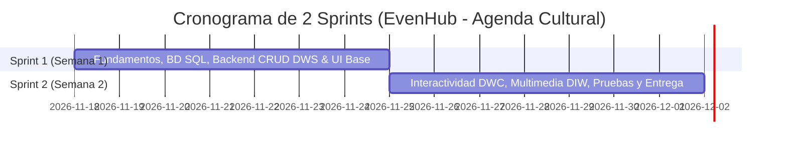

# 🏉 EvenHub — Planificación Ágil & Scrum Sprint Backlog (2 Sprints)

> **Proyecto:** EvenHub — Agenda Cultural  
> **Repositorio:** [bbaakkuu-svg/EvenHub-Agenda-Cultural](https://github.com/bbaakkuu-svg/EvenHub-Agenda-Cultural)  
> **Tablero de Proyecto:** [GitHub Projects — Flock (#12)](https://github.com/users/bbaakkuu-svg/projects/12)  
> **Metodología:** Scrum con 2 Sprints de 1 semana de duración cada uno (Total: 2 semanas)

---

## 📅 1. Cronograma Ejecutivo (2 Sprints de 1 Semana)

| Sprint | Fechas | Duración | Objetivo Clave de Entrega | Issues | Story Points |
| :---: | :---: | :---: | :--- | :---: | :---: |
| **Sprint 1** | 18 Nov – 25 Nov 2026 | 1 Semana | Incremento funcional base: Arquitectura, modelo SQL relacional, conexión PDO, CRUD completo de eventos, reserva de inscripciones, control de aforo, login de administración y layout responsive base. | 13 | **68 SP** |
| **Sprint 2** | 25 Nov – 02 Dic 2026 | 1 Semana | Incremento final y entrega: Validaciones dinámicas JS/Regex, manipulación DOM, cookies, objeto propio, 5 imágenes optimizadas, audio, vídeo, animación gráfica, tema alternativo, auditoría XSS/SQLi, pruebas cross-browser, manual de instalación y defensa. | 14 | **58 SP** |
| **TOTAL** | **2 Semanas** | **14 Días** | **Producto Completo Listo para Evaluación (10/10 en Rúbrica)** | **27** | **126 SP** |

---

## 👥 2. Organización del Equipo y Reparto de Roles

| Perfil en el Equipo | Responsabilidades Troncales | Módulos Principales |
| :--- | :--- | :--- |
| **Backend Lead** | Arquitectura PHP, conexión PDO robusta, lógica CRUD, control de aforo, sesiones y seguridad en servidor. | **DWS** & Database |
| **Frontend Lead** | Interactividad en navegador, validaciones Regex, eventos del DOM, cookies de preferencias y objeto propio estructurado. | **DWC** & JavaScript |
| **UI/UX & Multimedia Lead** | Maquetación responsive (Bootstrap + CSS), tema alternativo (alto contraste/oscuro), edición y optimización de 5 imágenes, audio, vídeo y animación. | **DIW** & Media |
| **QA / DevOps Lead (Rotativo)** | Casos de prueba manuales y cross-browser, control de ramas Git Flow, manual de instalación en XAMPP y preparación de la defensa oral. | **Transversal** |

---

## 📐 3. Definición de Hecho (Definition of Done - DoD)

Una tarjeta se considera **Done** cuando:
1. Ha sido desarrollada en su propia rama `feature/...` y cuenta con Pull Request aprobado hacia `develop`.
2. Las consultas a base de datos están 100% parametrizadas con sentencias preparadas PDO.
3. Todas las salidas de variables dinámicas están sanitizadas con `htmlspecialchars()`.
4. El código no produce `Notice`, `Warning` ni excepciones no controladas en PHP ni errores en la consola del navegador.
5. Se incluye o actualiza la documentación y evidencias correspondientes en la carpeta `docs/`.

---

## 📊 4. Desglose Detallado de Tareas por Sprint

### 🏃 SPRINT 1 (Semana 1: 18 Nov – 25 Nov 2026) — Milestone #1
**Objetivo del Sprint:** Desplegar el núcleo funcional del backend con persistencia relacional completa, operaciones CRUD de eventos, reserva de inscripciones y la maquetación visual base.

| Issue | Título de la Tarea | Módulo | Prioridad | Est. (SP) | Asignación Recomendada |
| :---: | :--- | :---: | :---: | :---: | :--- |
| **#1** | `docs: Propuesta Inicial y Especificacion de Alcance de EventHub` | Transversal | Alta | 3 SP | Product Owner / Todos |
| **#2** | `database: Diseno del Modelo Relacional y Script SQL (docs/sql/schema.sql)` | DWS | Crítica | 5 SP | Backend Lead |
| **#3** | `ui/ux: Documento de Diseno, Wireframes y Guia de Estilo Visual (docs/diseno.md)` | DIW | Alta | 5 SP | UI/UX Lead |
| **#4** | `feat(core): Estructura Base del Proyecto, Plantillas Maestras y Configuracion` | DWS / DIW | Alta | 5 SP | Full-Stack |
| **#5** | `docs: Memoria Tecnica de Arquitectura Cliente-Servidor (docs/tecnica.md)` | DWC / DWS | Media | 3 SP | Frontend / Backend |
| **#6** | `feat(backend): Modulo de Conexion PDO y Control de Excepciones` | DWS | Crítica | 5 SP | Backend Lead |
| **#7** | `feat(backend): Catalogo y Listado de Eventos con Filtrado Tradicional (GET)` | DWS | Alta | 5 SP | Backend Lead |
| **#8** | `feat(backend): Vista de Detalle del Evento y Disponibilidad de Aforo` | DWS | Alta | 5 SP | Backend Lead |
| **#9** | `feat(backend): Formulario de Publicacion y Edicion de Eventos (CRUD Completo)` | DWS | Alta | 8 SP | Full-Stack |
| **#10** | `feat(backend): Baja de Eventos con Confirmacion y Control de Integridad` | DWS | Media | 3 SP | Backend Lead |
| **#11** | `feat(backend): Sistema de Inscripcion de Asistentes a Eventos` | DWS | Alta | 8 SP | Full-Stack |
| **#12** | `security: Control de Sesiones y Proteccion del Panel de Administracion` | DWS | Crítica | 5 SP | Backend Lead |
| **#17** | `ui/ux: Maquetacion Responsive con Bootstrap y Estilos CSS Personalizados` | DIW | Alta | 8 SP | UI/UX Lead |
| **TOTAL** | **Sprint Backlog 1 (Semana 1)** | | | **68 SP** | **13 Tareas** |

---

### 🏃 SPRINT 2 (Semana 2: 25 Nov – 02 Dic 2026) — Milestone #2
**Objetivo del Sprint:** Implementar la interactividad cliente completa (DWC), la integración multimedia y temas accesibles (DIW), auditar la seguridad, ejecutar pruebas cruzadas y consolidar toda la documentación para la entrega y defensa oral.

| Issue | Título de la Tarea | Módulo | Prioridad | Est. (SP) | Asignación Recomendada |
| :---: | :--- | :---: | :---: | :---: | :--- |
| **#13** | `feat(frontend): Validacion Dinamica de Formularios con JavaScript y Regex` | DWC | Alta | 5 SP | Frontend Lead |
| **#14** | `feat(frontend): Manipulacion del DOM e Interactividad con Objetos Nativos` | DWC | Media | 3 SP | Frontend Lead |
| **#15** | `feat(frontend): Persistencia de Preferencias del Usuario mediante Cookies` | DWC | Media | 3 SP | Frontend Lead |
| **#16** | `feat(frontend): Modulo de Gestion con Objeto Propio y Patron de Diseno JS` | DWC | Media | 5 SP | Frontend Lead |
| **#18** | `ui/ux: Hoja de Estilos Alternativa y Tema Accesible (Modo Oscuro / Alto Contraste)` | DIW | Media | 5 SP | UI/UX Lead |
| **#19** | `multimedia: Preparacion, Edicion y Optimizacion de Recursos Multimedia Web` | DIW | Alta | 5 SP | UI/UX Lead |
| **#20** | `multimedia: Integracion de Reproductores Multimedia e Interactividad Visual` | DIW | Media | 5 SP | Frontend / UI/UX |
| **#21** | `security: Auditoria de Seguridad: Prevencion XSS, SQLi y Manejo de Errores` | DWS | Crítica | 5 SP | Backend / QA |
| **#22** | `test: Plan y Registro de Pruebas Funcionales, Responsive y Cross-Browser` | Transversal | Alta | 5 SP | QA / Todos |
| **#23** | `docs: Manual de Instalacion y Despliegue en XAMPP / Apache (docs/instalacion.md)` | Transversal | Alta | 3 SP | DevOps / Todos |
| **#24** | `docs: Guia de Uso de la Aplicacion y Diagrama Entidad-Relacion` | Transversal | Media | 3 SP | UI/UX / Backend |
| **#25** | `docs: Actualizacion del README.md Principal e Indices de Documentacion` | Transversal | Media | 2 SP | Product Owner |
| **#26** | `transversal: Verificacion de Entrega Limpia, Git Flow y Rubrica Completa` | Transversal | Crítica | 3 SP | Todos |
| **#27** | `transversal: Guion de Defensa Oral y Preparacion de Entrevistas Individuales` | Transversal | Alta | 5 SP | Individual (Cada integrante) |
| **TOTAL** | **Sprint Backlog 2 (Semana 2)** | | | **58 SP** | **14 Tareas** |

---

## 🔄 5. Ritmo de Trabajo en Sprints de 1 Semana

Para completar con éxito un sprint de 1 semana:
1. **Lunes (Sprint Planning & Inicio):** Reparto de tarjetas del Sprint en el tablero Flock, creación de ramas `feature/...`.
2. **Martes a Jueves (Desarrollo & Dailies de 10 min):** Implementación técnica, revisión de código en PRs locales o en GitHub.
3. **Viernes (Sprint Review & Retrospectiva):** Verificación del incremento funcional (DoD) y merge a la rama `develop`.
