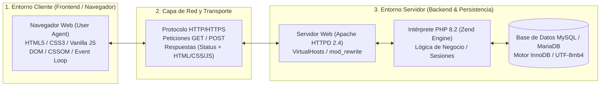
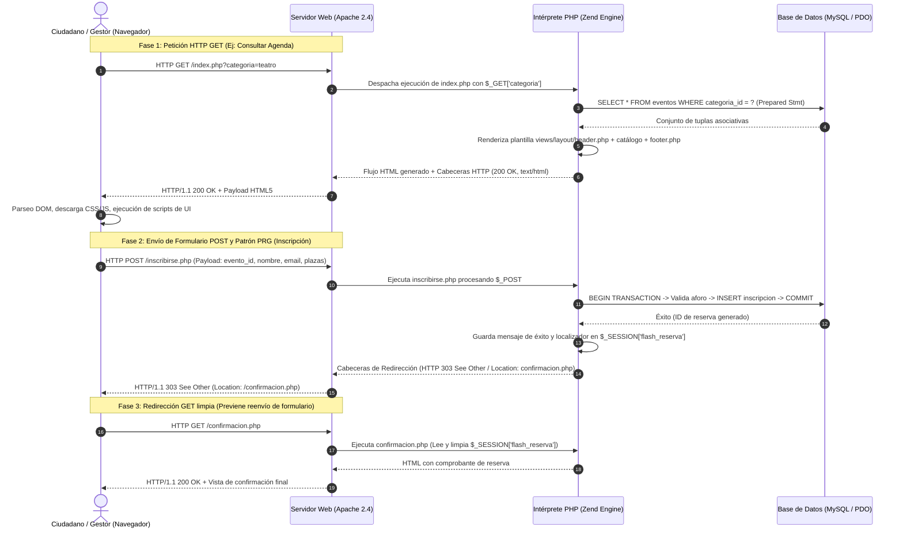
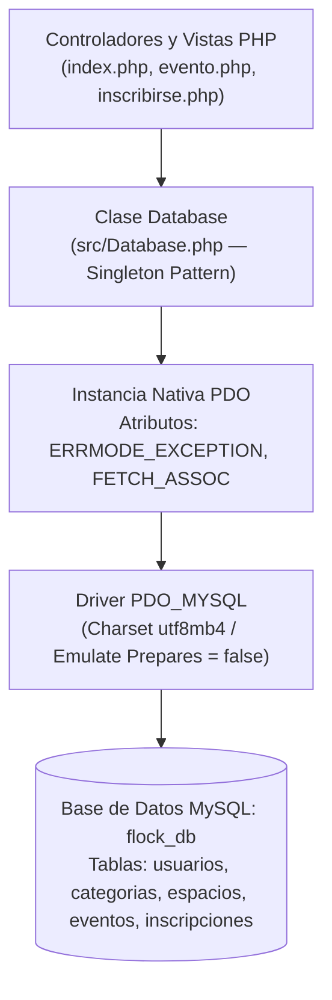
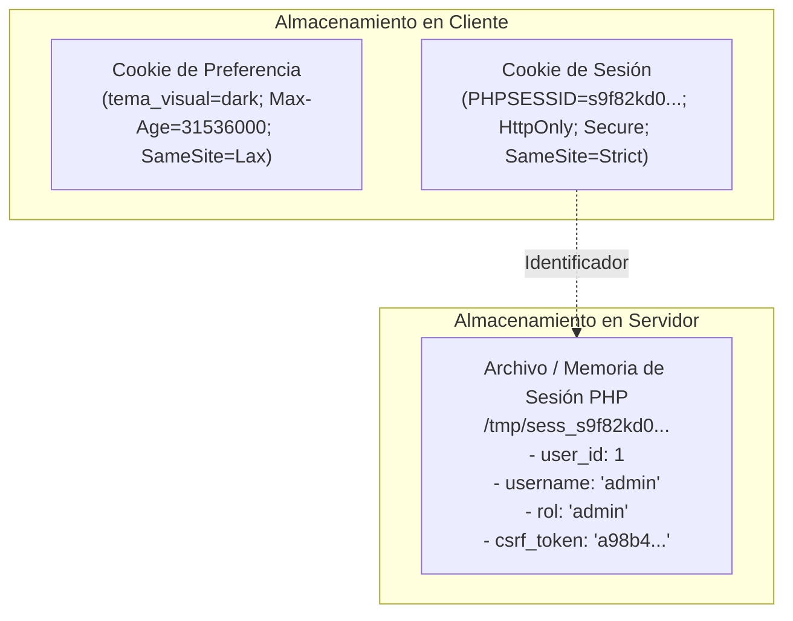

# 🏛️ FLOCK — Agenda Cultural Municipal
## Memoria Técnica de Arquitectura Web y Modelo Cliente-Servidor
**Temática:** FLOCK — Agenda Cultural de Villaverde de la Ribera  
**Módulos Curriculares:** Desarrollo Web Servidor (DWS RA1), Desarrollo Web Cliente (DWC RA1) y Diseño de Interfaces Web (DIW RA1)  
**Ciclo Formativo:** 2º Desarrollo de Aplicaciones Web (DAW) — 1º Trimestre  
**Equipo Técnico:** Grupo REDBULL (RDB)  
**Documento:** `docs/tecnica.md` — Entrega y Justificación de Arquitectura Técnica  

---

## 📑 Índice de Contenidos
1. [Introducción y Fundamentos del Modelo Cliente-Servidor](#1-introducción-y-fundamentos-del-modelo-cliente-servidor)
2. [Entorno de Ejecución en Servidor vs. Entorno de Ejecución en Cliente](#2-entorno-de-ejecución-en-servidor-vs-entorno-de-ejecución-en-cliente)
3. [Generación Dinámica de Páginas Web (SSR) vs. Sitios Estáticos](#3-generación-dinámica-de-páginas-web-ssr-vs-sitios-estáticos)
4. [Ciclo de Vida de una Petición HTTP Tradicional y Patrón PRG](#4-ciclo-de-vida-de-una-petición-http-tradicional-y-patrón-prg)
5. [Mecanismo de Ejecución de PHP e Integración con el Servidor Web](#5-mecanismo-de-ejecución-de-php-e-integración-con-el-servidor-web)
6. [Capa de Persistencia, Conectividad y Seguridad con PDO](#6-capa-de-persistencia-conectividad-y-seguridad-con-pdo)
7. [Rol, Alcance y Limitaciones de JavaScript en Entorno Cliente](#7-rol-alcance-y-limitaciones-de-javascript-en-entorno-cliente)
8. [Gestión del Estado: Sesiones en Servidor vs. Cookies en Cliente](#8-gestión-del-estado-sesiones-en-servidor-vs-cookies-en-cliente)
9. [Justificación del Ecosistema de Herramientas y Entorno de Desarrollo](#9-justificación-del-ecosistema-de-herramientas-y-entorno-de-desarrollo)
10. [Conclusiones y Cumplimiento de Resultados de Aprendizaje](#10-conclusiones-y-cumplimiento-de-resultados-de-aprendizaje)

---

## 1. Introducción y Fundamentos del Modelo Cliente-Servidor

La aplicación web **FLOCK** ha sido diseñada y estructurada bajo el paradigma de **arquitectura web clásica cliente-servidor en dos/tres capas**. En este modelo, las responsabilidades computacionales, de almacenamiento y de presentación se distribuyen de manera clara y desacoplada entre dos agentes principales conectados a través del protocolo estándar de transporte e hipertexto (TCP/IP y HTTP/1.1 o HTTP/2):



### Componentes de la Arquitectura:
1. **El Cliente (User Agent / Navegador Web):** Actúa como interfaz de usuario gráfica e interactiva. Es responsable exclusivo de solicitar recursos remotos al servidor, decodificar y maquetar los flujos de hipertexto y estilos (HTML5 semántico y CSS3), y ejecutar de forma aislada scripts de cliente (JavaScript) destinados a enriquecer la usabilidad y experiencia de usuario.
2. **El Servidor Web y de Aplicaciones (Apache HTTPD + Motor PHP 8.2):** Actúa como el centro neurálgico de cómputo y autoridad. Escucha peticiones entrantes en los puertos de red estandarizados (80 / 443), atiende peticiones estáticas directamente (hojas de estilo, imágenes, tipografías) y despacha las peticiones dinámicas al intérprete de PHP para procesar la lógica de negocio, verificar autorizaciones y orquestar transacciones.
3. **El Servidor de Base de Datos Relacional (MySQL / MariaDB):** Proporciona almacenamiento persistente, estructurado y transaccional (con soporte ACID mediante el motor InnoDB) para los catálogos de eventos, usuarios gestores, espacios culturales e inscripciones ciudadanas.

---

## 2. Entorno de Ejecución en Servidor vs. Entorno de Ejecución en Cliente

Una de las premisas fundamentales de la ingeniería de software web es la estricta distinción entre el contexto en el que se ejecuta el código en el servidor y aquel en el que se ejecuta en el cliente. Ambos ecosistemas poseen objetivos, capacidades y restricciones radicalmente distintos:

| Dimensión de Análisis | Entorno Servidor (Backend) | Entorno Cliente (Frontend) |
| :--- | :--- | :--- |
| **Tecnologías y Motores** | PHP 8.2 (Zend Engine), Apache 2.4, MySQL / PDO. | HTML5, CSS3, JavaScript (ECMAScript 6+, V8 / SpiderMonkey / WebKit). |
| **Ubicación de Ejecución** | Máquina del servidor local o en la nube (host remoto de la institución). | Dispositivo terminal del usuario final (PC, portátil, tablet, smartphone). |
| **Acceso a Recursos de Sistema** | Acceso directo y completo al sistema de archivos del servidor, sockets de red, bases de datos internas y variables de entorno del sistema operativo. | Entorno estrictamente aislado (sandbox del navegador). Sin acceso directo al sistema de archivos local ni a sockets arbitrarios de red externa. |
| **Confidencialidad del Código** | Código fuente privado y protegido. El cliente nunca visualiza el código fuente `.php`, las cadenas de conexión a base de datos, contraseñas ni claves criptográficas. | Código público y transparente. Todo archivo HTML, CSS o JS enviado al navegador puede ser inspeccionado, auditado o modificado mediante DevTools. |
| **Seguridad y Validación** | **Crítica y Autoritaria.** Es la única barrera de seguridad insalvable. Aplica sanitización rigurosa, hashes criptográficos y validación defensiva de tipos. | **Ergonómica y de Usabilidad.** Proporciona feedback instantáneo al usuario; no constituye una barrera de seguridad porque puede desactivarse o manipularse fácilmente. |
| **Persistencia del Estado** | Variables de sesión en memoria/disco del servidor (`$_SESSION`), coordinadas mediante cookie de identificación (`PHPSESSID`), y persistencia en BD relacional. | Almacenamiento local volátil (memoria de pestañas), almacenamiento en cookies de cliente (`document.cookie`) o `localStorage` / `sessionStorage`. |

---

## 3. Generación Dinámica de Páginas Web (SSR) vs. Sitios Estáticos

La arquitectura adoptada en **FLOCK** es la **generación dinámica de páginas en el servidor (Server-Side Rendering - SSR)**, frente al modelo estático puro o al modelo de aplicación en página única (SPA). Las razones técnicas que justifican esta decisión curricular y arquitectónica son:

1. **Frescura Inmediata de Datos y Cómputo de Aforo en Tiempo Real:**  
   En una agenda cultural municipal, el estado de un evento cambia continuamente (plazas ocupadas, aforo agotado, cambios de sala o cancelaciones). En un sitio estático, cada cambio exigiría regenerar y desplegar archivos HTML estáticos. Con PHP dinámico, cada petición `GET /evento.php?id=3` ejecuta una consulta parametrizada a la base de datos que calcula al vuelo las plazas restantes (`aforo_maximo - COUNT(inscripciones)`), garantizando información 100% veraz y actualizada sin desfases de caché.

2. **Centralización y Blindaje de la Lógica de Negocio:**  
   El control de acceso al área de gestión municipal (`/admin/`), la verificación de contraseñas mediante algoritmos seguros como Bcrypt (`password_verify()`) y el proceso de inserción transaccional de inscripciones vecinales ocurren exclusivamente en el servidor. El navegador del vecino o visitante únicamente recibe el producto terminado: una estructura de marcado HTML5 semántica y accesible.

3. **Accesibilidad Universal y Optimización SEO:**  
   Dado que el portal cultural es un servicio público de un ayuntamiento, debe ser plenamente legible por motores de búsqueda, lectores de pantalla para personas con discapacidad visual y navegadores con capacidades limitadas o JavaScript deshabilitado. Al servir HTML completo generado en el servidor, el contenido se indexa y se muestra sin depender de la descarga, parseo y ejecución de voluminosos paquetes JavaScript en el dispositivo cliente.

---

## 4. Ciclo de Vida de una Petición HTTP Tradicional y Patrón PRG

El modelo de interacción de FLOCK respeta el estándar de ciclo de petición y respuesta HTTP sin intermediación de APIs REST ni renderizado SPA asíncrono para las vistas principales.

### 4.1. Diagrama de Secuencia del Ciclo de Vida HTTP



### 4.2. El Patrón Post/Redirect/Get (PRG)

Uno de los patrones de diseño más importantes implementados en FLOCK es el **Post/Redirect/Get (PRG)** para el procesamiento de todos los formularios del sistema (inscripción ciudadana, login de gestor y creación/edición/borrado de eventos):

1. **Problema sin PRG:**  
   Si una petición `POST` responde directamente con el código `200 OK` y el HTML resultante, cuando el usuario recarga la página pulsando `F5` o vuelve hacia atrás en el historial, el navegador muestra la temida advertencia: *"¿Desea volver a enviar el formulario?"*. Si el usuario acepta, se duplica la inscripción o la reserva de plazas en la base de datos.
2. **Solución adoptada con PRG:**  
   - El script que procesa el formulario (`POST`) realiza las mutaciones en la base de datos de forma transaccional.
   - Si la operación tiene éxito o falla, almacena el resultado o los mensajes de error en la sesión del usuario (`$_SESSION['feedback']`).
   - El servidor finaliza inmediatamente con una directiva de redirección HTTP 303 o 302:
     ```php
     header('Location: confirmacion.php?codigo=' . urlencode($localizador));
     exit();
     ```
   - El navegador recibe la cabecera `Location` y automáticamente efectúa una petición inocua `GET /confirmacion.php`. De esta forma, si el vecino pulsa `F5`, solo recarga la vista informativa sin riesgo alguno de duplicar datos.

---

## 5. Mecanismo de Ejecución de PHP e Integración con el Servidor Web

### 5.1. Integración entre Apache HTTPD y PHP
En el entorno de desarrollo y explotación (Apache 2.4 en plataforma XAMPP sobre Windows), el servidor web se comunica con PHP mediante una de dos arquitecturas estándar:
- **Módulo embebido (`mod_php`):** Apache carga la biblioteca dinámica de PHP (`php8apache2_4.dll`) directamente en sus procesos de trabajo. Cada hilo de Apache es capaz de interpretar código PHP sin necesidad de pasarelas de procesos independientes.
- **FastCGI / PHP-FPM:** Alternativa orientada a alto rendimiento donde Apache delega las peticiones `.php` a través de un socket o puerto TCP (`127.0.0.1:9000`) a un gestor de procesos independiente (`php-fpm`), desacoplando la memoria del servidor web de la del intérprete.

### 5.2. Ciclo de Vida del Script PHP (Zend Engine)
Cuando Apache detecta una solicitud de un recurso con extensión `.php`, el motor Zend ejecuta un proceso de cuatro etapas secuenciales:
1. **Análisis Léxico (Tokenización / Lexing):** El analizador divide el código fuente en tokens semánticos (palabras clave, operadores, literales).
2. **Análisis Sintáctico y Generación del AST (Parsing):** Genera un Árbol de Sintaxis Abstracta (Abstract Syntax Tree) comprobando la corrección gramatical del lenguaje.
3. **Compilación a Opcodes:** Transforma el AST en un conjunto de instrucciones elementales de bajo nivel denominadas *opcodes* (optimizables en memoria mediante el caché de operaciones OPcache).
4. **Ejecución en la Máquina Virtual Zend:** La máquina virtual ejecuta las instrucciones de los opcodes, interactúa con extensiones cargadas (como `pdo_mysql`, `mbstring`, `openssl`), procesa flujos de entrada/salida y emite las cabeceras HTTP y el contenido final hacia el servidor web.

### 5.3. Integración de PHP en el Lenguaje de Marcado HTML
PHP utiliza delimitadores formales (`<?php ... ?>`) que permiten alternar de manera fluida entre lógica de control y fragmentos estáticos de marcado HTML:
```php
<?php if (!empty($eventos)): ?>
    <div class="row row-cols-1 row-cols-md-3 g-4">
        <?php foreach ($eventos as $evento): ?>
            <div class="col">
                <article class="flock-card">
                    <span class="badge" style="background-color: <?= htmlspecialchars($evento['color_badge']) ?>">
                        <?= htmlspecialchars($evento['categoria_nombre']) ?>
                    </span>
                    <h3><?= htmlspecialchars($evento['titulo']) ?></h3>
                    <p><?= htmlspecialchars($evento['espacio_nombre']) ?></p>
                    <a href="evento.php?id=<?= (int)$evento['id'] ?>" class="btn-flock">Ver detalles</a>
                </article>
            </div>
        <?php endforeach; ?>
    </div>
<?php else: ?>
    <p class="alert alert-info">No se encontraron eventos culturales programados para este criterio.</p>
<?php endif; ?>
```

### 5.4. Ámbitos de Variables y Superglobales
PHP gestiona de manera rigurosa el ámbito de las variables:
- **Variables locales:** Declaradas dentro de funciones o métodos, destruidas automáticamente al salir del contexto funcional.
- **Variables de script:** Visibles en el flujo global del archivo y scripts incluidos (`require_once`).
- **Superglobales (`$_GET`, `$_POST`, `$_SESSION`, `$_COOKIE`, `$_SERVER`):** Arrays asociativos accesibles automáticamente en cualquier ámbito sin necesidad de la directiva `global`. En FLOCK, todos los accesos a datos externos se tratan como potencialmente maliciosos y se filtran exhaustivamente (`filter_input()`, `htmlspecialchars()`, `(int)` cast).

---

## 6. Capa de Persistencia, Conectividad y Seguridad con PDO

La interacción entre la aplicación PHP y el motor relacional MySQL se articula mediante la extensión orientada a objetos **PDO (PHP Data Objects)**.



### 6.1. Justificación de PDO frente a `mysqli` tradicional
1. **Abstracción Orientada a Objetos:** Ofrece una interfaz consistente y moderna que independiza el código de la base de datos subyacente.
2. **Sentencias Preparadas Nativas:** Permite parametrizar las sentencias SQL en el motor de base de datos antes de enlazar los valores, eliminando de raíz el riesgo de inyecciones SQL (SQL Injection).
3. **Gestión Unificada de Excepciones:** Configurado con `PDO::ATTR_ERRMODE => PDO::ERRMODE_EXCEPTION`, transforma cualquier anomalía de base de datos en un objeto `PDOException`, posibilitando un control de errores limpio mediante bloques `try-catch` sin exponer información interna del sistema al cliente.

### 6.2. Configuración Estricta de Seguridad en la Conexión
```php
$dsn = "mysql:host=" . DB_HOST . ";dbname=" . DB_NAME . ";charset=utf8mb4";
$options = [
    PDO::ATTR_ERRMODE            => PDO::ERRMODE_EXCEPTION,
    PDO::ATTR_DEFAULT_FETCH_MODE => PDO::FETCH_ASSOC,
    PDO::ATTR_EMULATE_PREPARES   => false, // Utiliza sentencias preparadas nativas en MySQL
    PDO::MYSQL_ATTR_INIT_COMMAND => "SET NAMES utf8mb4 COLLATE utf8mb4_unicode_ci"
];
$pdo = new PDO($dsn, DB_USER, DB_PASS, $options);
```

---

## 7. Rol, Alcance y Limitaciones de JavaScript en Entorno Cliente

En el marco de la asignatura **Desarrollo Web Cliente (DWC)**, el rol de JavaScript en FLOCK responde a una estrategia disciplinada de **Mejora Progresiva (Progressive Enhancement)**:

### 7.1. Responsabilidades de JavaScript en FLOCK
1. **Validación de Formularios en Tiempo Real (Ergonomía de Entrada):**  
   Antes de que el usuario envíe una inscripción o formulario de acceso, JavaScript valida el cumplimiento de patrones sintácticos (formato de correo electrónico según RFC 5322, DNI/NIE español mediante algoritmo de letra de control y número positivo de plazas) utilizando expresiones regulares (`RegExp`). Si se detecta un error, se manipula el DOM para señalar el campo erróneo y mostrar un mensaje explicativo sin recargar la página.
2. **Manipulación Dinámica del DOM y Usabilidad:**  
   - Alternancia entre vista mensual de calendario y vista de listado de tarjetas sin refresco de página.
   - Apertura y cierre de ventanas modales accesibles para confirmaciones de borrado o reserva.
   - Gestión del menú colapsable (Navbar responsive) en pantallas móviles mediante eventos táctiles.
3. **Persistencia Local de Preferencias:**  
   Almacenamiento y recuperación de la preferencia de accesibilidad visual (tema oscuro / contraste alto) a través de cookies gestionadas por script (`document.cookie`), aplicando la clase CSS pertinente al cargar el documento antes del primer pintado.

### 7.2. Capacidades y Limitaciones de Seguridad en Cliente
> [!IMPORTANT]
> **Principio de Confianza Cero en el Cliente:**  
> Ninguna verificación realizada en JavaScript puede considerarse segura para el sistema. El usuario tiene control total sobre su entorno de ejecución: puede deshabilitar JavaScript en el navegador, alterar los scripts mediante la consola de desarrollo o formular peticiones HTTP arbitrarias utilizando herramientas como `cURL` o Postman.
> Por este motivo, **cada regla de validación ejecutada en JavaScript en el cliente se replica de forma idéntica e ineludible en PHP en el servidor**. La validación en cliente tiene como único fin ahorrar viajes de ida y vuelta al servidor (roundtrips) y ofrecer una respuesta visual inmediata.

---

## 8. Gestión del Estado: Sesiones en Servidor vs. Cookies en Cliente

Dado que el protocolo HTTP es un protocolo sin estado (*stateless*), el sistema debe coordinar mecanismos robustos para mantener la continuidad entre peticiones consecutivas:



### Comparativa de Mecanismos de Estado:
1. **Sesiones de Servidor (`$_SESSION`):**  
   - **Contenido:** Identidad autenticada del técnico municipal, rol de permisos (`admin` o `gestor`), tokens de seguridad anti-CSRF y mensajes de feedback flash.
   - **Seguridad:** Los datos residen en el servidor. El cliente únicamente conserva una clave alfanumérica aleatoria (`PHPSESSID`) transmitida en una cookie con atributos de seguridad reforzados (`HttpOnly` para impedir su lectura desde JavaScript y prevenir ataques XSS, y `SameSite=Strict` para neutralizar ataques CSRF).
2. **Cookies de Cliente (`document.cookie`):**  
   - **Contenido:** Exclusivamente datos no sensibles de personalización estética (ej. `flock_theme=dark`).
   - **Seguridad:** Accesibles y modificables por el navegador; nunca contienen credenciales, identificadores internos de sesión ni información personal del usuario.

---

## 9. Justificación del Ecosistema de Herramientas y Entorno de Desarrollo

Para garantizar el cumplimiento de los estándares de calidad de la industria y las directrices docentes del proyecto, se ha seleccionado el siguiente ecosistema técnico:

- **Apache HTTP Server 2.4:** Servidor web maduro, robusto y altamente compatible con el ecosistema PHP a través de módulos nativos.
- **PHP 8.2 (CLI y Módulo Apache):** Versión moderna del lenguaje con sistema de tipado estricto, atributos nativos, optimizaciones de rendimiento en el motor Zend y constantes mejoras de seguridad.
- **MySQL 8.x / MariaDB:** Motor de base de datos relacional estándar de facto en la web tradicional, con soporte íntegro de claves foráneas, restricciones de integridad referencial y transacciones ACID bajo InnoDB.
- **XAMPP v8.2:** Plataforma de desarrollo local estandarizada y multiplataforma que garantiza homogeneidad técnica entre los integrantes del equipo.
- **Bootstrap 5.3 (Uso Mínimo / Quirúrgico):** Empleado exclusivamente para el sistema de rejilla adaptable (`container`, `row`, `col-*`) y el componente de barra de navegación responsive (`navbar`), delegando el 100% de la identidad gráfica, tarjetas culturales y componentes a CSS3 nativo.
- **Git & GitHub Flow:** Sistema de control de versiones distribuido. Se implementa una política rigurosa de ramas (`develop` como rama de integración, `feature/issue-X-...` para el desarrollo atómico de cada tarea), trazabilidad estricta con issues (`#X`) y confirmaciones limpias sin artefactos ajenos al código fuente.

---

## 10. Conclusiones y Cumplimiento de Resultados de Aprendizaje

El diseño técnico de **FLOCK** expuesto en este informe acredita el dominio de las competencias clave evaluadas en este primer hito del proyecto:

- **DWS RA1 (Criterios a, b, c, d, e, f, g):** Se ha fundamentado la arquitectura cliente-servidor tradicional, contrastado la ejecución dinámica frente a la estática, detallado el ciclo de vida del intérprete PHP y su integración con Apache y MySQL mediante PDO, justificando con rigor técnico cada elección de infraestructura.
- **DWC RA1 (Criterios a, b, c, d, e):** Se ha delimitado con precisión el entorno del navegador, su aislamiento de seguridad, su interacción con los flujos de respuesta del servidor y la estricta subordinación de la validación en cliente frente a la seguridad autoritaria del backend.
- **Criterios Transversales de Ingeniería del Software:** Organización modular del código, separación de responsabilidades, protección de datos sensibles y documentación técnica exhaustiva para la defensa oral individual y colectiva del proyecto.
