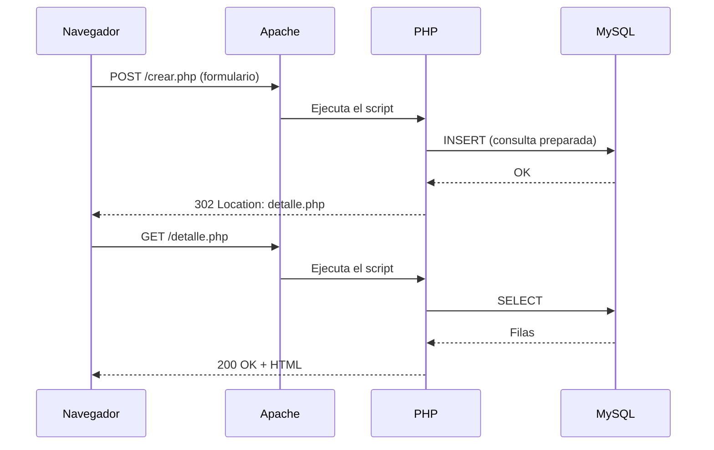

# Memoria técnica: EventHub – Agenda Cultural

## 1. Resumen de la arquitectura

EventHub se ha construido con una **arquitectura web tradicional multipágina**: PHP genera el HTML en el servidor, JavaScript y CSS aportan comportamiento y presentación en el navegador, y MySQL conserva los datos. La comunicación se hace únicamente con enlaces y formularios convencionales (GET y POST). No hay API REST, ni SPA, ni `fetch()`.

| Capa | Tecnología | Dónde se ejecuta |
|---|---|---|
| Presentación | HTML5, CSS3, Bootstrap `[VERIFICAR]` | Navegador |
| Comportamiento | JavaScript (vanilla) | Navegador |
| Servidor web | Apache (XAMPP) | Servidor |
| Lógica de aplicación | PHP con PDO | Servidor |
| Persistencia | MySQL / MariaDB | Servidor |
| Control de versiones | Git + GitHub | Repositorio del equipo |

```
Navegador ──GET/POST──► Apache ──► PHP (PDO) ──► MySQL
   ▲                                  │
   └────────── HTML generado ◄────────┘
```

## 2. Recorrido de una petición HTTP

**Ejemplo GET: listado de actividades.**

1. El usuario pulsa un enlace. El navegador resuelve el host, abre la conexión TCP y envía `GET /index.php?categoria=musica HTTP/1.1` con las cabeceras `Host`, `Cookie` y `Accept`. 
2. **Apache** recibe la petición, la asocia al `DocumentRoot` del proyecto y, al tratarse de un `.php`, la entrega al intérprete de PHP.
3. **PHP** se ejecuta en el servidor: lee `$_GET`, recupera la sesión si procede (`session_start()`) y abre la conexión **PDO**.
4. Lanza una consulta preparada sobre **MySQL** (`SELECT ... FROM actividades WHERE categoria = :c`) y recibe las filas. `[VERIFICAR nombres de tabla]`
5. PHP recorre los resultados con un bucle y los inserta en la plantilla HTML, escapando la salida con `htmlspecialchars()`.
6. Apache responde `200 OK` con `Content-Type: text/html` y el documento ya completo.
7. El navegador construye el DOM, solicita los recursos enlazados (CSS, JS, imágenes, audio, vídeo) con nuevas peticiones GET y ejecuta el JavaScript.

**Ejemplo POST: crear una actividad o inscribirse.**

1. El navegador envía el formulario (`method="post"`) con los datos en el cuerpo de la petición.
2. PHP los recibe en `$_POST`, **valida en el servidor**, comprueba sesión y permisos y ejecuta un `INSERT` con consulta preparada.
3. Responde con una **redirección** (`header('Location: ...')`, código 302) al listado o al detalle. Es el patrón *Post/Redirect/Get*: evita que al recargar se reenvíe el formulario.
4. El navegador sigue la redirección con un GET y muestra la confirmación o el error.



## 3. Ejecución en cliente y en servidor: responsabilidades

### Servidor (Apache + PHP + MySQL)

- **Procesamiento:** lógica de la aplicación, filtrado, generación de las vistas con PHP embebido en HTML.
- **Persistencia:** CRUD de la entidad principal y consulta de la relacionada, mediante PDO. `[VERIFICAR entidades]`
- **Sesiones y autenticación:** `session_start()`, contraseñas con `password_hash()` / `password_verify()`, protección de operaciones restringidas. `[VERIFICAR si hay cuentas]`
- **Seguridad:** validación definitiva de todos los datos, consultas preparadas contra inyección SQL y escape de la salida contra XSS.

### Cliente (navegador)

- **Renderizado:** el navegador interpreta HTML y CSS y construye el DOM.
- **Interactividad:** JavaScript gestiona eventos y modifica el documento mediante `document` y `window`. `[VERIFICAR funcionalidades concretas]`
- **Validación:** el formulario se valida con JavaScript (expresiones regulares y control del evento `submit`) para dar respuesta inmediata.
- **Preferencia del usuario:** se guarda en una **cookie** no sensible (por ejemplo, el tema alternativo). `[VERIFICAR]`

**Regla de diseño:** el cliente mejora la experiencia, pero **nunca es de fiar**. Cualquier validación del navegador se repite en el servidor porque puede saltarse.

## 4. Tecnologías y su integración con HTML

### PHP en el servidor

PHP se mezcla con el marcado dentro de los ficheros `.php`: Apache ejecuta los bloques `<?php ... ?>` y envía al navegador solo el HTML resultante, sin rastro del código PHP.

Apache y PHP se integran mediante `mod_php` o PHP-FPM (según la configuración de XAMPP `[VERIFICAR]`). No se usa servidor de aplicaciones: el proyecto no lo necesita.

### JavaScript en el navegador

- Se enlaza con `<script src="js/app.js" defer></script>`, de modo que no bloquea la carga del HTML. `[VERIFICAR ruta]`
- Opera sobre el DOM que PHP ya ha generado y sin JavaScript la aplicación sigue funcionando con enlaces y formularios; con él gana validación y comodidad.
- El código se organiza en funciones reutilizables y al menos un objeto propio con propiedades y métodos. `[VERIFICAR nombre y patrón aplicado]`
- Particularidades de los scripts: se interpretan en el navegador, tipado dinámico, ejecución dirigida por eventos y acceso limitado por la seguridad del navegador.

### HTML y CSS

HTML aporta la estructura semántica; CSS externo (con Bootstrap y estilos propios) aporta presentación responsive. El detalle visual se documenta en el documento de diseño.

## 5. Justificación de la arquitectura frente a una solución en cliente (SPA)

| Criterio | Tradicional (PHP + MySQL) | SPA + API |
|---|---|---|
| Complejidad | Un solo proyecto, un lenguaje de servidor | Dos proyectos, framework, API, CORS |
| Primera carga y SEO | HTML completo desde el servidor | Depende de descargar y ejecutar JS |
| Seguridad | Sesiones, validación y acceso a datos solo en servidor | Más superficie: tokens, CORS, lógica expuesta |
| Despliegue | Apache + PHP + MySQL (XAMPP) | Frontend y backend por separado |

**Ventajas de generar páginas dinámicamente en el servidor:**

- El contenido siempre refleja el estado actual de la base de datos.
- La lógica y los datos permanecen en el servidor, fuera del alcance del usuario.
- El navegador solo necesita interpretar HTML, CSS y un poco de JavaScript, por lo que funciona en cualquier dispositivo.

**Por qué es adecuada para EventHub:** es una agenda de consulta con formularios sencillos (publicar actividades, inscribirse), sin necesidad de funciones en tiempo real. El enfoque tradicional resuelve esos flujos con menos complejidad y coincide con el alcance exigido por el proyecto.

**Limitaciones asumidas:**

- Cada acción recarga la página, por lo que la experiencia es menos fluida que en una SPA.
- Parte de la carga recae en el servidor.
- Para una futura app móvil habría que exponer una API.

## 6. Herramientas utilizadas

| Ámbito | Herramienta | Uso |
|---|---|---|
| Entorno servidor | XAMPP (Apache, PHP, MySQL) | Ejecución local del proyecto |
| Base de datos  | phpMyAdmin / MySQL Workbench | Diseño, importación de `schema.sql` y pruebas |
| Editor | VS Code | Programación de PHP, JS y CSS |
| Depuración en cliente | DevTools del navegador | *Console* (errores JS), *Elements* (DOM y CSS), *Network* (peticiones, códigos de estado, cabeceras), *Application* (cookies) |
| Depuración en servidor | Log de errores de Apache y PHP, `var_dump()` | Diagnóstico de errores de PHP y de configuración |
| Validación | W3C CSS Validator | Comprobación de la hoja de estilos |
| Versionado | Git + GitHub | Historial y trabajo en equipo |